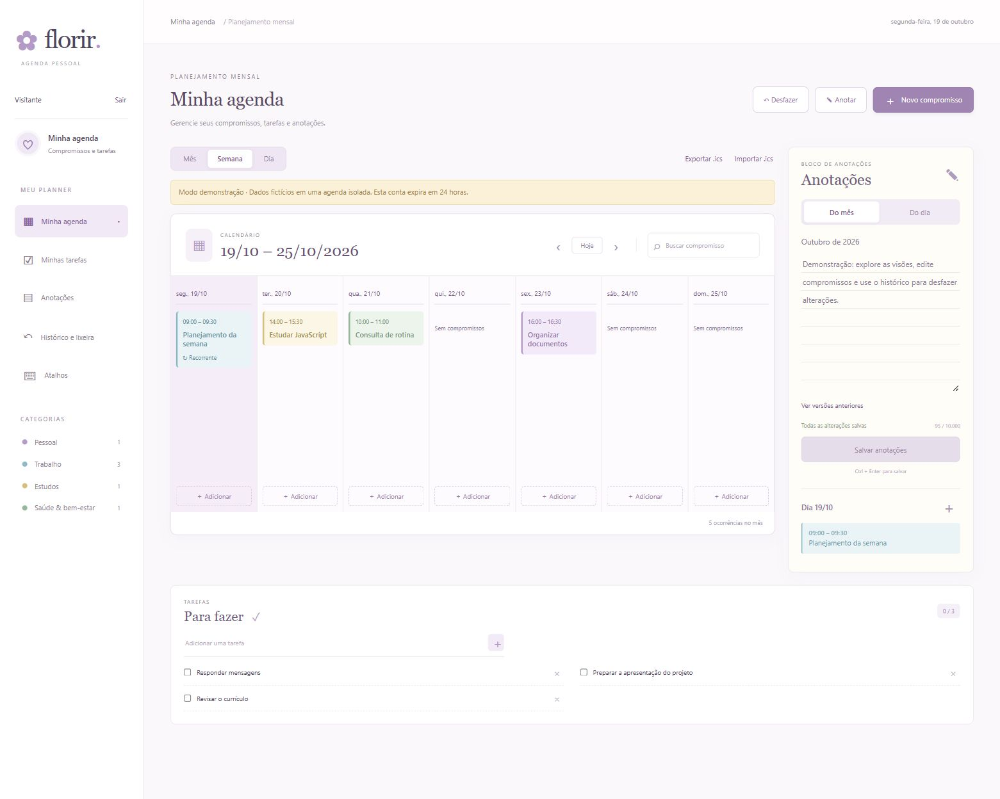
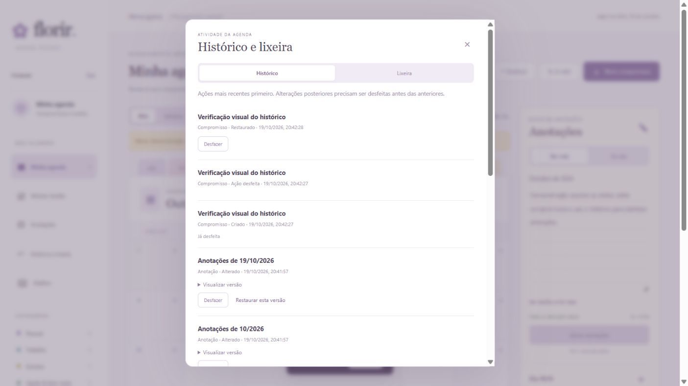

# Florir · Agenda pessoal

Agenda com calendário mensal, semanal e diário, anotações, tarefas e histórico persistente. Front-end em HTML, CSS e JavaScript; API em Node.js 24; SQLite no servidor. Sem dependências externas de execução.



## Executar

Requer Node.js 24 ou superior.

```sh
npm start
```

Abra http://localhost:3000. Use `npm run dev` para reiniciar o servidor ao editar arquivos.

A agenda abre diretamente, sem login, cadastro ou demonstração. Compromissos, tarefas, anotações e histórico continuam disponíveis. Se já havia uma conta pessoal, a agenda local usa os dados da primeira conta pessoal; dados de demonstração não são misturados.

## Funcionalidades

- Calendário mensal, semanal e diário, com busca e filtro por categoria.
- Compromissos com edição, conclusão, lixeira e restauração.
- Recorrência diária, semanal e mensal, com fim definido em até um ano. Edições e exclusões afetam a série inteira. Meses sem o dia escolhido são pulados.
- Detecção de conflitos na criação, edição, restauração e importação, com opção explícita de manter a sobreposição.
- Tarefas com conclusão, lixeira e desfazer.
- Anotações mensais e diárias em painel lateral, contador, estado de salvamento, rascunhos durante a navegação e versões anteriores.
- Histórico paginado com data, item e tipo de alteração. Uma ação só pode ser desfeita se o item ainda estiver no estado resultante dela; isso impede sobrescrever edições posteriores.
- Botão de desfazer na confirmação da ação, botão global e histórico disponível após atualizar a página.
- Importação e exportação de calendários `.ics`, sem duplicar eventos idênticos.
- Layout responsivo, campos rotulados, foco visível, link para pular a navegação e respeito à preferência de movimento reduzido.



## Como usar

Clique no dia para abrir as anotações e os compromissos correspondentes. Use o `+` do dia ou **Novo compromisso** para cadastrar. Nos horários, digite `0930` para obter `09:30`.

Ao excluir um item, use **Desfazer** na mensagem de confirmação ou abra **Histórico e lixeira**. Para recuperar uma anotação antiga, abra **Ver versões anteriores**, visualize o texto e escolha **Restaurar esta versão**. A restauração também cria uma entrada no histórico.

| Atalho | Ação |
| --- | --- |
| N | Novo compromisso |
| / | Buscar |
| M / S / D | Visão mensal / semanal / diária |
| Alt + Z | Desfazer última alteração |
| Ctrl + Enter ou Cmd + Enter | Salvar anotação |
| Esc | Fechar janela |

Os atalhos globais não atuam dentro de campos de edição. Ctrl + Z continua disponível para editar texto normalmente.

## Arquitetura e decisões

```text
Navegador
  public/index.html  · estrutura e formulários acessíveis
  public/style.css   · tema pastel e regras responsivas
  public/app.js      · calendário, rascunhos, conta, histórico e API
       │ HTTP / JSON + cookie de sessão
  server.js          · rotas, autorização e validação
       ├─ lib/auth.js      · senhas e sessões
       ├─ lib/calendar.js  · recorrência, conflitos e ICS
       └─ lib/store.js     · SQLite, migração, transações e desfazer
```

**Por que SQLite:** persistência simples em um arquivo e transações para manter a alteração e seu histórico juntos. A implantação usa uma instância com volume persistente. Várias réplicas exigiriam outra estratégia de banco.

**Por que recorrência calculada:** a série fica em uma linha; suas ocorrências são calculadas no período consultado. Isso evita duplicar dezenas de registros e torna a edição da série consistente.

**Como funciona desfazer:** cada alteração registra o estado anterior e posterior dentro da mesma transação. Antes de restaurar o anterior, o servidor compara o estado atual com o posterior. Se houve outra edição, o servidor retorna conflito. Exclusões preservam os registros com `deleted_at`.

**Como os dados existentes são preservados:** a execução local seleciona a primeira conta pessoal existente, ou os registros locais originais quando nenhuma conta foi criada. Não apaga contas, registros ou histórico. O front-end não escolhe o proprietário dos registros.

**Proteção de migração:** o primeiro início desta versão cria um backup do banco antigo e migra os dados em uma transação. A migração é idempotente e tem teste com banco legado.

## Testes e desempenho

```sh
npm test
npm run benchmark
```

Os testes cobrem CRUD, isolamento entre contas, login/logout, histórico, lixeira, restauração de versões, recorrência entre meses, ano bissexto, conflitos, arquivos ICS, validação e preservação dos dados legados. Usam bancos de teste e não modificam a agenda pessoal.

O workflow `.github/workflows/ci.yml` está preparado para executar os testes em Windows e Linux a cada push e pull request. Ele ainda precisa ser enviado ao GitHub para executar lá. As ações usadas seguem os exemplos oficiais de [checkout](https://github.com/actions/checkout) e [setup-node](https://github.com/actions/setup-node).

O benchmark usa 10.000 registros fictícios. Consulte [método e resultados](docs/performance.md); não confunda o tempo das consultas em memória com a latência completa do aplicativo.

A revisão funcional e de segurança ampliou a bateria para 44 testes. Veja a [cobertura, correções e limites da auditoria local](docs/auditoria.md).

## API principal

Na execução local padrão, as rotas de dados abrem a agenda pessoal diretamente. O suporte anterior de autenticação permanece no back-end para testes e configurações com `REQUIRE_AUTH=1` ou produção; a interface atual não contém telas de conta.

| Método | Rota | Função |
| --- | --- | --- |
| GET | /api/auth/session | Consultar sessão |
| POST | /api/auth/register, /api/auth/login, /api/auth/logout | Gerenciar acesso |
| POST | /api/auth/demo | Criar demonstração isolada |
| GET | /api/events?month=2026-10 | Listar ocorrências no mês |
| GET | /api/events?from=2026-10-01&to=2026-11-06 | Consultar até 62 dias |
| POST | /api/events | Criar compromisso ou série |
| PUT, DELETE | /api/events/:id | Editar ou mover para a lixeira |
| GET, POST | /api/tasks | Listar ou criar tarefas |
| PATCH, DELETE | /api/tasks/:id | Concluir ou mover para a lixeira |
| GET, PUT | /api/notes?month=2026-10 | Ler ou salvar anotação mensal |
| GET | /api/day-notes?month=2026-10 | Listar anotações diárias |
| PUT | /api/day-notes/2026-10-19 | Salvar anotação diária |
| GET | /api/history?offset=0 | Listar 30 alterações |
| POST | /api/history/:id/undo | Desfazer alteração |
| POST | /api/history/:id/version | Restaurar versão de anotação |
| GET | /api/trash | Consultar lixeira |
| POST | /api/trash/event/:id/restore | Restaurar compromisso |
| POST | /api/trash/task/:id/restore | Restaurar tarefa |
| GET | /api/calendar/export | Baixar calendário ICS |
| POST | /api/calendar/import | Importar ICS |

## Importação e limites

O importador aceita até 200 eventos em um arquivo de até 500 KB. Exporta horários locais; importa horários locais, America/Sao_Paulo ou UTC convertido para São Paulo. Usa precisão de minutos (segundos 00). Não aceita eventos de dia inteiro, eventos que atravessam a meia-noite, outros fusos, exceções de recorrência, componentes VTIMEZONE/VALARM ou regras avançadas. Rejeita o arquivo inteiro antes de gravar se encontrar formato não suportado. Não é uma sincronização contínua com Google ou Outlook.

Ainda não há lembretes em segundo plano, compartilhamento de agendas, recuperação de senha ou verificação de e-mail. O histórico começa a registrar alterações nesta versão; ações anteriores à migração não podem ser reconstruídas.

## Publicação e backup

Consulte [publicação e configuração](docs/deployment.md). Há Dockerfile e `.env.example`. A publicação online depende de conectar um provedor com armazenamento persistente; nenhum endereço público foi publicado nesta entrega.

Por padrão, o servidor escuta apenas em `127.0.0.1`. Os dados e backups ficam em `data/`, ignorada pelo Git. Para backup completo, pare o servidor e copie a pasta `data` para armazenamento privado. O arquivo ICS exporta compromissos, não o banco inteiro.
