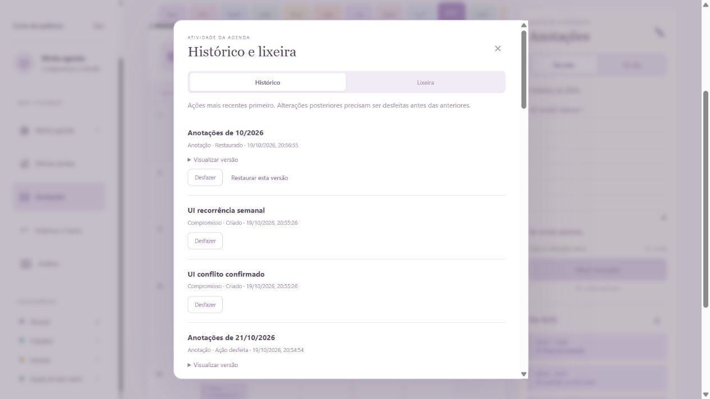

# Verificação funcional e de segurança

Data: 19/10/2026. Ambiente: Windows, Node.js 24.19.0.

## Resultado

**44 testes automatizados passaram, sem falhas.** Também foram exercitados fluxos reais no navegador.

Os testes automatizados usam bancos em memória e um banco legado temporário para verificar a migração. A verificação visual usou um servidor separado na porta 3101, com uma conta fictícia e SQLite em memória. Não foram adicionados, editados ou excluídos dados da agenda pessoal na porta 3000.

## Cobertura

| Área | Cenários verificados | Forma |
| --- | --- | --- |
| Conta | Cadastro, login correto/incorreto e logout | API e navegador |
| Sessão | Expiração, cookie falsificado, token armazenado como hash e atributos do cookie | API |
| Isolamento | Outra conta não lê, altera, exclui, restaura ou desfaz itens do proprietário | API |
| Compromissos | Criar, editar, concluir, excluir, restaurar e desfazer nas quatro categorias | API; criação/edição/exclusão/desfazer também no navegador |
| Horários | Máscara de digitação, horário inválido, ordem de início/término e sobreposição | API e navegador |
| Recorrência | Diária, semanal, mensal, limite final, meses sem dia 31, ano bissexto e mudança de mês | API; semanal entre meses também no navegador |
| Calendário | Mês, semana, dia, navegação, busca e categorias | Navegador |
| Tarefas | Criar, concluir, excluir, restaurar e desfazer | API e navegador |
| Anotações | Salvar, editar, esvaziar, desfazer exclusão, separar mês/dia, Unicode, limite de tamanho e restaurar versões | API e navegador |
| Histórico | Registros, versões, desfazer apenas no estado esperado e paginação sem duplicação | API e navegador |
| Lixeira | Exclusão recuperável, restauração, tentativa de restauração duplicada e acesso entre contas | API; recuperação de exclusão também pelo desfazer no navegador |
| Importação/exportação | Round-trip ICS, acentos, escapes, linhas dobradas, duplicados, conflitos internos, formato truncado e rejeição atômica | API e testes do parser |
| Entradas hostis | Texto com HTML/SQL, JSON inválido, tipos errados, tamanho excessivo e identificadores fora da faixa segura | API; HTML também verificado como texto no navegador |
| Requisições | Host externo, origem externa, Content-Type errado, URL malformada e tentativa de acessar arquivos privados | API/HTTP |
| Concorrência | Cadastro com mesmo e-mail, sobreposição simultânea, corpo atrasado após exclusão e restauração duplicada | API/HTTP |
| Produção | Código da primeira conta, dados legados protegidos, origem pública, cookie Secure e cabeçalhos CSP | Servidor de teste configurado em modo produção |
| Migração | Dados antigos preservados, backup criado e migração idempotente | Banco temporário |
| Interface | Menu em tela baixa, foco dos filtros, checkbox de tarefa, aviso que pode ser fechado, atalho N e Ctrl + Enter | Navegador |
| Responsividade | Largura de 390 px, documento com 375 px de conteúdo, sem transbordamento horizontal da página | Navegador |

## Problemas encontrados e corrigidos

1. **Conflitos dentro do mesmo arquivo importado.** Dois eventos ainda sem ID eram considerados o mesmo registro e não eram comparados. Agora só se ignora o próprio registro quando há um ID definido. Uma importação conflitante é recusada antes de gravar; a sobreposição só é permitida após confirmação explícita.
2. **Cadastro concorrente com o mesmo e-mail.** Duas requisições podiam passar pela verificação anterior ao hash da senha, e a segunda terminava em erro interno. A unicidade é verificada novamente dentro da transação; o retorno agora é conflito 409.
3. **Host não validado.** O servidor aceitava um nome de host arbitrário quando a origem combinava com ele. Agora aceita apenas o endereço local com a porta real do servidor ou o host público configurado.
4. **JSON enviado como texto simples.** Rotas que leem JSON aceitavam `text/plain`. Agora exigem `application/json` e retornam 415 para tipos incompatíveis.
5. **Estado lido antes de receber todo o corpo.** Uma edição atrasada podia modificar um registro já excluído; duas restaurações podiam registrar a mesma recuperação. O estado é consultado depois da leitura do corpo e imediatamente antes da operação síncrona/transação.
6. **Tratamento de URL malformada.** A criação da URL ficava fora do tratamento de erros. Agora URLs inválidas ou no formato absoluto são rejeitadas com 400, sem interromper o servidor.
7. **Validação de calendário importado.** Agora datas impossíveis são rejeitadas antes da conversão UTC; segundos não nulos, nomes de fuso apenas semelhantes, campos essenciais duplicados, componentes não suportados e arquivos incompletos também são rejeitados. A recorrência mensal foi corrigida para anos anteriores a 100.
8. **Usabilidade.** O menu lateral agora permite rolagem em telas baixas. Os filtros preservam o foco ao atualizar; concluir uma tarefa atualiza o mesmo checkbox, sem reconstruir a lista. Avisos ganharam botão de fechar. A página começa oculta até a verificação da sessão, evitando exibir a área da agenda durante esse carregamento.
9. **Validação de tipos e números.** Horários precisam ser strings; IDs e offsets precisam estar na faixa de inteiros seguros do JavaScript.

Os quatro primeiros problemas foram reproduzidos por uma rodada de regressão com quatro falhas. Depois das correções, esses mesmos casos passaram. Casos adicionais foram incluídos para verificar as correções de concorrência, importação e configuração de produção.

## Reproduzir

```sh
npm test
node --test test/security.test.js
node --test test/production.test.js
```

Os testes de produção simulam a configuração HTTPS nos cabeçalhos e verificam o cookie Secure, mas a conexão de teste é HTTP local. Não substituem uma verificação do proxy/TLS em uma hospedagem real.

## Limites

Não foi feito teste de intrusão externo, teste de carga distribuída, nem validação de uma hospedagem publicada ou do contêiner Docker. O importador implementa um subconjunto explícito de ICS, não todo o padrão. A bateria passou nos cenários descritos; isso não constitui garantia de ausência de vulnerabilidades fora deles.

Anotações em duas abas ainda seguem a última gravação recebida; as versões anteriores ficam recuperáveis no histórico. Um próximo incremento útil é comparar versões ao salvar para detectar edições concorrentes antes da substituição.


